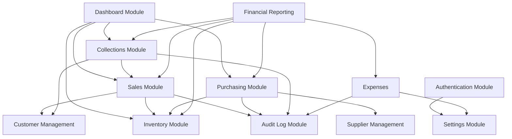

# Enterprise Business Management System - High-Level Design (HLD)

**System:** BusinessHub Management System  
**Document Reference:** `docs/architecture/HLD.md`  
**Version:** 1.0.0  
**Architectural Pattern:** Modular Monolith on Cloudflare Edge Serverless  
**Target Infrastructure:** Cloudflare Workers, Cloudflare D1, Cloudflare R2, Cloudflare Static Assets  

---

## 1. Executive Summary

This High-Level Design (HLD) establishes the architectural blueprint for **BusinessHub**, a unified business management platform providing end-to-end management of products, inventory, procurement, sales, collections, expenses, and financial intelligence.

The system is architected as a **Modular Monolith** executed on Cloudflare's serverless edge infrastructure. This eliminates cold-starts, reduces latency to near-zero globally, guarantees deterministic integer financial transactions, and provides enterprise data integrity without the operational complexity and failure modes of distributed microservices.

---

## 2. System Overview (Section 2.1)

### 2.1.1 Product Objectives
- Provide a single, dependable operational ledger for trading, wholesale, distribution, and commercial service enterprises.
- Eliminate data desynchronization between inventory counts, sales invoices, procurement bills, and financial reporting.
- Enforce strict double-entry invariants, integer paise precision, and immutable audit trails.
- Provide sub-100ms response times at the edge with zero server maintenance overhead.

### 2.1.2 Main Business Capabilities
```
+---------------------------------------------------------------------------------------------------------+
|                                      BUSINESSHUB CAPABILITIES                                          |
+---------------------+---------------------+---------------------+-------------------+-------------------+
|     PROCUREMENT     |      INVENTORY      |        SALES        |    COLLECTIONS    |    INTELLIGENCE   |
+---------------------+---------------------+---------------------+-------------------+-------------------+
| • Supplier Master   | • Stock Ledger      | • Customer Master   | • Cash/Bank/UPI   | • Real-time P&L   |
| • Purchase Orders   | • Reorder Tracking  | • Estimates/Quotes  | • Multi-Invoice   | • Stock Valuation |
| • Inward GRN/Bills  | • Inward/Outward    | • GST Sales Invoices|   Allocation      | • AP/AR Aging     |
| • Debit Notes       | • Audit Adjustments | • Dispatch Notes    | • Unallocated     | • GST Tax Reports |
| • AP Tracking       | • FIFO / WAC Costing| • Credit Notes (Ret)|   Credit Ledgers  | • SKU Margin Rep  |
+---------------------+---------------------+---------------------+-------------------+-------------------+
```

### 2.1.3 System Boundaries
- **Inside System Scope:** Authentication, user access control, product catalog, inventory tracking, purchase workflows, sales lifecycles, payment vouchers, customer & supplier ledgers, expense logging, financial computation, audit recording, and file storage for business assets.
- **Outside System Scope:** Direct banking API integrations (e.g., auto-debit webhooks; manual reconciliation is used), external payment gateway checkouts (collections recorded upon receipt), and third-party logistics courier tracking.

### 2.1.4 User Roles & Permissions
Initially designed on a **Single-Owner / Controlled Admin** model to eliminate complex multi-tenant leaks and public signup risks:
1. **Owner / Principal Admin:** Full operational and administrative access: financial reports, settings, user creation, inventory overrides, database backup.
2. **Manager / Staff (Future Extension):** Operations on orders, invoices, collections, and inventory checks without access to profit & loss, system settings, or raw audit logs.

### 2.1.5 External Dependencies
- **Cloudflare Workers Runtime:** V8 serverless isolate execution.
- **Cloudflare D1:** SQLite-compatible relational database with transactional boundaries.
- **Cloudflare R2:** S3-compatible object storage for logos, attachments, and invoice PDFs.
- **Cloudflare Static Assets:** CDN-cached distribution of client-side application bundles.

### 2.1.6 Security Boundaries
- **Edge Security Barrier:** Cloudflare DDoS protection, TLS 1.3 termination, rate-limiting, and Web Application Firewall (WAF).
- **Application Security Boundary:** Mandatory session authentication on all `/api/v1/*` endpoints (except `/api/v1/auth/login`).
- **Database Boundary:** Cloudflare D1 accessed exclusively through parameterized queries in typed repository layers. No direct external SQL connections.

---

## 3. System Architecture (Section 2.2)

The system strictly follows a 5-layer **Modular Monolithic Layered Architecture**:

```
+---------------------------------------------------------------------------------------+
|                                  PRESENTATION LAYER                                   |
|   SPA / Static Client (React, TypeScript, Tailwind CSS, Reusable Design System)        |
+---------------------------------------------------------------------------------------+
                                           |  HTTPS / REST JSON (/api/v1/*)
                                           v
+---------------------------------------------------------------------------------------+
|                                  APPLICATION LAYER                                    |
|   Cloudflare Worker Router, Middleware (Auth, CORS, Rate Limit, Input Validation)    |
+---------------------------------------------------------------------------------------+
                                           |  DTOs & Commands
                                           v
+---------------------------------------------------------------------------------------+
|                             DOMAIN / BUSINESS LOGIC LAYER                             |
|   Domain Services (SalesService, InventoryService, PurchaseService, FinancialService) |
|   - Invariant Enforcement, State Transitions, Double-Entry Validations                |
+---------------------------------------------------------------------------------------+
                                           |  Domain Entities & Interface Calls
                                           v
+---------------------------------------------------------------------------------------+
|                              REPOSITORY / DATA ACCESS LAYER                           |
|   Repositories (SalesRepo, InventoryRepo, LedgerRepo, AuthRepo)                      |
|   - Parameterized SQL, D1 Prepared Statements, Unit-of-Work Transactions              |
+---------------------------------------------------------------------------------------+
                                           |  Prepared SQL Statements
                                           v
+---------------------------------------------------------------------------------------+
|                                 INFRASTRUCTURE LAYER                                  |
|   Cloudflare D1 (SQLite Edge DB)       Cloudflare R2 (Document / Media Storage)       |
+---------------------------------------------------------------------------------------+
```

### Architecture Guarantees:
1. **Separation of Concerns:** UI components never execute business calculations or issue SQL statements.
2. **Strict Layer Direction:** Outer layers call inward; inner layers never depend on outer layers.
3. **Repository Abstraction:** Domain services interact with database repositories via typed TypeScript interfaces, allowing pure in-memory mocking during unit tests.

---

## 4. Module Architecture (Section 2.3)

The system consists of 13 independent modules. Modules communicate exclusively through public service interfaces, never through direct database cross-mutations:



### Module Responsibilities & Public Interfaces:

| Module | Core Responsibility | Public Interface Exported |
|---|---|---|
| **Authentication** | Password verification, Session token creation/validation, Revocation | `IAuthService` (`login`, `logout`, `validateSession`) |
| **Dashboard** | Aggregate business health, KPI rollups, low-stock warnings | `IDashboardService` (`getExecutiveSummary`, `getAlerts`) |
| **Product Management**| SKU catalog, HSN codes, UOM, tax slabs, pricing | `IProductService` (`create`, `update`, `getById`, `list`) |
| **Inventory Management**| Stock balances, immutable stock movement ledger, adjustments | `IInventoryService` (`recordMovement`, `getBalance`, `verifyStockAvailability`) |
| **Purchasing** | Purchase orders, inward goods receipts, purchase bills, returns | `IPurchaseService` (`createPO`, `confirmBill`, `createReturn`) |
| **Supplier Management**| Vendor records, payable balances, supplier ledger statements | `ISupplierService` (`create`, `getLedger`, `updateBalance`) |
| **Sales** | Quotations, sales orders, GST invoices, dispatch, credit notes | `ISalesService` (`createInvoice`, `confirmInvoice`, `createReturn`) |
| **Customer Management**| Client records, credit limits, receivable balances, aging | `ICustomerService` (`create`, `getLedger`, `checkCreditLimit`) |
| **Collections** | Cash/Bank receipts, invoice settlement allocation | `ICollectionService` (`recordPayment`, `allocateToInvoices`) |
| **Expenses** | Operational expenditure vouchers, vendor receipts | `IExpenseService` (`recordExpense`, `listByCategory`) |
| **Financial Reporting**| Real-time P&L, Balance Sheet derivation, COGS, Cash Flow | `IFinancialService` (`getProfitLoss`, `getStockValuation`, `getCashFlow`) |
| **Audit Logs** | Immutable audit tracking of all database modifications | `IAuditService` (`logAction`, `queryLogs`) |
| **Settings** | Organization profile, GSTIN, invoice sequence configuration | `ISettingsService` (`getSettings`, `updateSettings`) |

---

## 5. Data Flow Architecture (Section 2.4)

### 5.1 Product Creation Flow
```
User (UI) 
  --> POST /api/v1/products 
  --> Application Layer (Auth check & Zod validation)
  --> ProductService.createProduct()
  --> ProductRepository.insert() (D1)
  --> AuditService.logAction('PRODUCT_CREATED')
  --> Response (201 Created with JSON DTO)
```

### 5.2 Purchase Confirmation & Inward Stock Flow
```
User (UI)
  --> POST /api/v1/purchases/:id/confirm
  --> PurchaseService.confirmPurchase(purchaseId)
  --> BEGIN TRANSACTION (D1)
      1. Verify Purchase Bill status is 'DRAFT'.
      2. Set Purchase Bill status to 'CONFIRMED'.
      3. For each item:
         - Calculate Weighted Average Cost (WAC) update.
         - Insert record into `inventory_movements` (type: 'PURCHASE_INWARD', qty: +N).
         - Update aggregate `inventory_balances` cached balance.
      4. Create Accounts Payable record in `supplier_ledger` (Credit: Bill Amount).
      5. Insert audit log record.
  --> COMMIT TRANSACTION (D1)
  --> Return confirmed purchase DTO
```

### 5.3 Sales Invoice Confirmation & Outward Stock Flow
```
User (UI)
  --> POST /api/v1/sales/:id/confirm
  --> SalesService.confirmInvoice(invoiceId)
  --> BEGIN TRANSACTION (D1)
      1. Verify Invoice status is 'DRAFT'.
      2. For each line item:
         - Verify stock availability (`current_stock >= requested_qty`).
         - If insufficient, abort and rollback with `INSUFFICIENT_STOCK_ERROR`.
      3. For each item:
         - Insert record into `inventory_movements` (type: 'SALE_OUTWARD', qty: -N).
         - Update `inventory_balances` cached balance.
      4. Set Invoice status to 'ISSUED'.
      5. Create Accounts Receivable record in `customer_ledger` (Debit: Invoice Total).
      6. Insert audit log.
  --> COMMIT TRANSACTION (D1)
  --> Return issued invoice DTO
```

### 5.4 Payment Collection & Invoice Settlement Flow
```
User (UI)
  --> POST /api/v1/collections
  --> CollectionService.recordCollection(payload)
  --> BEGIN TRANSACTION (D1)
      1. Insert into `collections` (payment_mode, amount_paise, customer_id).
      2. If target invoice IDs are specified:
         - For each invoice: allocate payment amount.
         - Insert into `collection_allocations` (collection_id, invoice_id, allocated_paise).
         - Update invoice: `paid_amount_paise += allocated_paise`.
         - If `paid_amount_paise == total_amount_paise`: set status = 'PAID'.
         - Else: set status = 'PARTIALLY_PAID'.
      3. If surplus remains: record unallocated customer credit balance.
      4. Record Credit in `customer_ledger` (reducing receivable balance).
      5. Insert audit log.
  --> COMMIT TRANSACTION (D1)
  --> Return receipt voucher DTO
```

### 5.5 Sales Return Flow (Credit Note)
```
User (UI)
  --> POST /api/v1/sales/:id/return
  --> SalesService.createSalesReturn(invoiceId, returnedItems)
  --> BEGIN TRANSACTION (D1)
      1. Validate invoice exists and items are within originally invoiced quantities.
      2. Generate Credit Note record with unique numbering.
      3. For each returned item:
         - Insert `inventory_movements` (type: 'SALE_RETURN', qty: +N, cost: original COGS).
         - Update `inventory_balances`.
      4. Update Customer Ledger: Credit customer account (reducing receivable).
      5. Update Invoice status: set 'CREDITED' or adjust outstanding balance.
      6. Insert audit log.
  --> COMMIT TRANSACTION (D1)
  --> Return Credit Note DTO
```

### 5.6 Profit & Loss (P&L) Generation Flow
```
User (UI)
  --> GET /api/v1/reports/profit-loss?start_date=YYYY-MM-DD&end_date=YYYY-MM-DD
  --> FinancialService.calculateProfitLoss(startDate, endDate)
  --> Execute deterministic derivation query:
      1. Gross Sales = SUM(sales_invoices.taxable_amount_paise) WHERE status IN ('ISSUED', 'PARTIALLY_PAID', 'PAID').
      2. Less: Sales Returns = SUM(credit_notes.taxable_amount_paise).
      3. Net Operating Revenue = Gross Sales - Sales Returns.
      4. Cost of Goods Sold (COGS) = SUM(inventory_movements.qty * inventory_movements.unit_cost_paise) 
         WHERE movement_type IN ('SALE_OUTWARD', 'DAMAGE_WRITE_OFF') - SUM(movement_type = 'SALE_RETURN').
      5. Gross Profit = Net Operating Revenue - COGS.
      6. Operating Expenses = SUM(expenses.amount_paise) WHERE expense_date BETWEEN start AND end.
      7. Net Operating Income = Gross Profit - Operating Expenses.
  --> Return structured P&L JSON with exact integer paise breakdown.
```

---

## 6. Security Architecture (Section 2.5)

### 6.1 Authentication Flow
```
User (Browser)               Worker Auth Handler                  D1 Database
      |                               |                                |
      |-- 1. POST /api/v1/auth/login ->|                                |
      |   { email, password }         |-- 2. Query user by email ----->|
      |                               |<- 3. Return salt, hash --------|
      |                               |-- 4. Verify PBKDF2 hash        |
      |                               |-- 5. Generate 256-bit token    |
      |                               |-- 6. Insert session record --->|
      |<- 7. 200 OK + Set-Cookie -----|                                |
      |   (HttpOnly, Secure, SameSite)|                                |
```

### 6.2 Session Lifecycle & Token Management
- **Token Type:** Cryptographically secure 256-bit random entropy hex string, hashed with SHA-256 before storing in `sessions` table.
- **Cookie Security Attributes:**
  - `HttpOnly`: Inaccessible to client JavaScript (eliminates token theft via XSS).
  - `Secure`: Transmitted only over HTTPS.
  - `SameSite=Strict`: Protects against Cross-Site Request Forgery (CSRF).
  - `Path=/api`: Restricted to API endpoints.
- **Session Duration:** Absolute expiry of 7 days; idle timeout of 24 hours.

### 6.3 Authorization Rules
- Every API endpoint checks session validity and maps `session.user_id` to the context.
- Client cannot supply `user_id` or `organization_id` in request payloads; these are strictly bound from the authenticated session context.

### 6.4 Input Validation & Sanitization
- All request bodies are strictly validated using **Zod** schemas before reaching domain services.
- Extraneous fields are automatically stripped.
- Numerical limits are enforced (e.g. quantity > 0, price >= 0).

### 6.5 Database Protection
- 100% of SQL statements execute via Cloudflare D1 parameterized queries (`db.prepare("...").bind(...)`).
- Dynamic string concatenation into SQL statements is prohibited by linting rules.

---

## 7. Deployment Architecture (Section 2.6)

```
                              [ Cloudflare Global Network ]
                                           |
                  +------------------------+------------------------+
                  |                                                 |
         [ Custom Domain ]                                 [ Cloudflare Assets ]
        hub.yourcompany.com                                    (SPA Frontend)
                  |                                                 |
                  v                                                 |
        [ Cloudflare Worker ] <-------------------------------------+
        (API Gateway & App Core)
                  |
         +--------+--------+
         |                 |
         v                 v
   [ Cloudflare D1 ] [ Cloudflare R2 ]
    (SQLite DB)       (Object Store)
```

### 7.1 Cloudflare Bindings
Defined in `wrangler.toml`:
```toml
name = "businesshub-api"
main = "src/index.ts"
compatibility_date = "2026-11-19"

[[d1_databases]]
binding = "DB"
database_name = "businesshub-production"
database_id = "d1-prod-guid"

[[r2_buckets]]
binding = "STORAGE"
bucket_name = "businesshub-media-prod"

[vars]
ENVIRONMENT = "production"
SESSION_TTL_SECONDS = "604800"
```

### 7.2 Database Migration & Rollback Workflow
1. Migrations are stored chronologically in `migrations/*.sql`.
2. Applied sequentially using `npx wrangler d1 migrations apply DB --local` (dev/testing) and `npx wrangler d1 migrations apply DB --remote` (production).
3. Rollbacks: Since D1 does not natively run backward migrations automatically, all production migrations are written with non-destructive additions. Rollbacks are performed via scripted compensating schema migrations.
