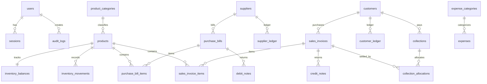

# Enterprise Database Schema Specification

**Database Engine:** Cloudflare D1 (SQLite Edge Engine)  
**Document Reference:** `docs/database/schema.md`  
**Version:** 1.0.0  
**Numeric Standard:** Integer Paise for Currency (`INTEGER`), Milli-Units for Quantities (`INTEGER`)  

---

## 1. Schema Design Principles

1. **Strict Relational Normalization:** 3rd Normal Form (3NF) across all transactional and master data entities.
2. **Deterministic Integer Math:** Floating-point types (`REAL`, `FLOAT`, `DOUBLE`) are prohibited for financial calculations and stock balances. All monetary values are represented as integer **paise** ($1\text{ INR} = 100\text{ paise}$). Quantities are represented as integer **milli-units** ($1.000\text{ Unit} = 1000\text{ milli-units}$).
3. **Foreign Key Integrity:** `PRAGMA foreign_keys = ON;` is enforced on every connection. Deleting referenced records with active historical transactions is strictly restricted (`ON DELETE RESTRICT`).
4. **Append-Only Ledgers:** `inventory_movements`, `customer_ledger`, `supplier_ledger`, and `audit_logs` are write-once, append-only logs.
5. **UTC ISO Timestamps:** All dates and timestamps are formatted as ISO 8601 strings in UTC (`datetime('now', 'utc')`).

---

## 2. Entity-Relationship Overview

---

## 3. Complete DDL Specifications

### 3.1 Authentication & System Administration

#### `users`
| Column | Type | Constraints | Description |
|---|---|---|---|
| `id` | TEXT | PRIMARY KEY | UUID v4 identifier |
| `email` | TEXT | UNIQUE NOT NULL COLLATE NOCASE | Normalized email address |
| `password_hash` | TEXT | NOT NULL | PBKDF2-SHA256 derived key |
| `password_salt` | TEXT | NOT NULL | 16-byte random salt (Base64) |
| `full_name` | TEXT | NOT NULL | User's full display name |
| `role` | TEXT | NOT NULL DEFAULT 'OWNER' | `OWNER`, `ADMIN`, `STAFF` |
| `is_active` | INTEGER | NOT NULL DEFAULT 1 | 1 = active, 0 = disabled |
| `created_at` | TEXT | NOT NULL DEFAULT (datetime('now', 'utc')) | UTC creation timestamp |
| `updated_at` | TEXT | NOT NULL DEFAULT (datetime('now', 'utc')) | UTC modification timestamp |

#### `sessions`
| Column | Type | Constraints | Description |
|---|---|---|---|
| `id` | TEXT | PRIMARY KEY | UUID v4 identifier |
| `user_id` | TEXT | NOT NULL REFERENCES users(id) ON DELETE CASCADE | Target user |
| `token_hash` | TEXT | UNIQUE NOT NULL | SHA-256 hash of session token |
| `ip_address` | TEXT | NULL | Client IP address |
| `user_agent` | TEXT | NULL | Client browser user agent |
| `expires_at` | TEXT | NOT NULL | Session expiry timestamp |
| `created_at` | TEXT | NOT NULL DEFAULT (datetime('now', 'utc')) | Timestamp |

#### `audit_logs`
| Column | Type | Constraints | Description |
|---|---|---|---|
| `id` | TEXT | PRIMARY KEY | UUID v4 identifier |
| `user_id` | TEXT | NOT NULL REFERENCES users(id) | Acting user |
| `action` | TEXT | NOT NULL | Action identifier (e.g. `INVOICE_CONFIRMED`) |
| `entity_type` | TEXT | NOT NULL | Target table name (e.g. `sales_invoices`) |
| `entity_id` | TEXT | NOT NULL | Target record primary key |
| `old_values_json`| TEXT | NULL | Previous state snapshot |
| `new_values_json`| TEXT | NULL | New state snapshot |
| `ip_address` | TEXT | NULL | Client IP |
| `created_at` | TEXT | NOT NULL DEFAULT (datetime('now', 'utc')) | Timestamp |

---

### 3.2 Product & Catalog Master Data

#### `product_categories`
| Column | Type | Constraints | Description |
|---|---|---|---|
| `id` | TEXT | PRIMARY KEY | Category UUID |
| `name` | TEXT | UNIQUE NOT NULL | Category name (e.g. "Plywood", "Hardware") |
| `parent_id` | TEXT | NULL REFERENCES product_categories(id) ON DELETE SET NULL | Hierarchical parent |
| `created_at` | TEXT | NOT NULL DEFAULT (datetime('now', 'utc')) | Timestamp |

#### `products`
| Column | Type | Constraints | Description |
|---|---|---|---|
| `id` | TEXT | PRIMARY KEY | Product UUID |
| `sku` | TEXT | UNIQUE NOT NULL COLLATE NOCASE | Stock Keeping Unit |
| `barcode` | TEXT | UNIQUE NULL | EAN/UPC barcode |
| `name` | TEXT | NOT NULL | Product commercial name |
| `description` | TEXT | NULL | Specifications / notes |
| `category_id` | TEXT | NOT NULL REFERENCES product_categories(id) | Category reference |
| `uom` | TEXT | NOT NULL DEFAULT 'PCS' | `PCS`, `KGS`, `MTR`, `LTR`, `BOX` |
| `hsn_code` | TEXT | NOT NULL | HSN/SAC code (e.g. "4412") |
| `tax_rate_bps` | INTEGER | NOT NULL DEFAULT 1800 | GST slab in basis points (1800 = 18%) |
| `cost_price_paise` | INTEGER | NOT NULL DEFAULT 0 | Default cost in paise |
| `selling_price_paise` | INTEGER | NOT NULL DEFAULT 0 | Default selling price in paise |
| `min_stock_alert_level` | INTEGER | NOT NULL DEFAULT 0 | Alert threshold in whole units |
| `is_active` | INTEGER | NOT NULL DEFAULT 1 | Active catalog flag |
| `created_at` | TEXT | NOT NULL DEFAULT (datetime('now', 'utc')) | Timestamp |
| `updated_at` | TEXT | NOT NULL DEFAULT (datetime('now', 'utc')) | Timestamp |

---

### 3.3 Inventory Tracking

#### `inventory_balances`
| Column | Type | Constraints | Description |
|---|---|---|---|
| `product_id` | TEXT | PRIMARY KEY REFERENCES products(id) ON DELETE RESTRICT | Target product |
| `current_stock_milli_units` | INTEGER | NOT NULL DEFAULT 0 | Stock in 1/1000th units |
| `weighted_avg_cost_paise` | INTEGER | NOT NULL DEFAULT 0 | Weighted average cost per unit |
| `last_updated_at` | TEXT | NOT NULL DEFAULT (datetime('now', 'utc')) | Timestamp |

#### `inventory_movements`
| Column | Type | Constraints | Description |
|---|---|---|---|
| `id` | TEXT | PRIMARY KEY | UUID v4 |
| `product_id` | TEXT | NOT NULL REFERENCES products(id) ON DELETE RESTRICT | Target product |
| `movement_type` | TEXT | NOT NULL | Movement code |
| `quantity_milli_units` | INTEGER | NOT NULL | Positive = Inward, Negative = Outward |
| `unit_cost_paise` | INTEGER | NOT NULL DEFAULT 0 | Cost basis at movement time |
| `balance_after_milli_units` | INTEGER | NOT NULL | Running balance snapshot |
| `reference_type` | TEXT | NOT NULL | e.g. `SALES_INVOICE`, `PURCHASE_BILL` |
| `reference_id` | TEXT | NOT NULL | Foreign record ID |
| `notes` | TEXT | NULL | Reason or remarks |
| `created_at` | TEXT | NOT NULL DEFAULT (datetime('now', 'utc')) | Timestamp |
| `created_by` | TEXT | NOT NULL REFERENCES users(id) | Acting user |

---

### 3.4 Purchasing & Suppliers

#### `suppliers`
| Column | Type | Constraints | Description |
|---|---|---|---|
| `id` | TEXT | PRIMARY KEY | UUID v4 |
| `name` | TEXT | NOT NULL | Vendor legal name |
| `contact_person`| TEXT | NULL | Contact representative |
| `phone` | TEXT | NOT NULL | Primary telephone |
| `email` | TEXT | NULL | Email |
| `gstin` | TEXT | NULL | 15-character GSTIN |
| `pan` | TEXT | NULL | 10-character PAN |
| `billing_address` | TEXT | NOT NULL | Vendor address |
| `payment_terms_days` | INTEGER | NOT NULL DEFAULT 30 | Standard credit terms |
| `bank_account_name` | TEXT | NULL | Bank account title |
| `bank_account_number` | TEXT | NULL | Bank account number |
| `bank_ifsc` | TEXT | NULL | IFSC code |
| `bank_name` | TEXT | NULL | Bank institution name |
| `current_payable_paise` | INTEGER | NOT NULL DEFAULT 0 | Net outstanding payable |
| `is_active` | INTEGER | NOT NULL DEFAULT 1 | Status |
| `created_at` | TEXT | NOT NULL DEFAULT (datetime('now', 'utc')) | Timestamp |
| `updated_at` | TEXT | NOT NULL DEFAULT (datetime('now', 'utc')) | Timestamp |

#### `supplier_ledger`
| Column | Type | Constraints | Description |
|---|---|---|---|
| `id` | TEXT | PRIMARY KEY | UUID v4 |
| `supplier_id` | TEXT | NOT NULL REFERENCES suppliers(id) ON DELETE RESTRICT | Vendor |
| `entry_date` | TEXT | NOT NULL | YYYY-MM-DD |
| `entry_type` | TEXT | NOT NULL | `PURCHASE_BILL`, `PAYMENT_DISBURSEMENT`, `DEBIT_NOTE` |
| `reference_id` | TEXT | NOT NULL | Target bill or voucher ID |
| `reference_number` | TEXT | NOT NULL | Reference string |
| `debit_paise` | INTEGER | NOT NULL DEFAULT 0 | Payments / Debit Notes |
| `credit_paise` | INTEGER | NOT NULL DEFAULT 0 | Invoiced bills |
| `running_balance_paise` | INTEGER | NOT NULL | Net liability balance |
| `notes` | TEXT | NULL | Remarks |
| `created_at` | TEXT | NOT NULL DEFAULT (datetime('now', 'utc')) | Timestamp |
| `created_by` | TEXT | NOT NULL REFERENCES users(id) | User |

#### `purchase_bills`
| Column | Type | Constraints | Description |
|---|---|---|---|
| `id` | TEXT | PRIMARY KEY | UUID v4 |
| `bill_number` | TEXT | UNIQUE NOT NULL | System internal bill number (PB-2026-0001) |
| `supplier_id` | TEXT | NOT NULL REFERENCES suppliers(id) ON DELETE RESTRICT | Vendor |
| `supplier_bill_number`| TEXT | NOT NULL | Vendor's original invoice number |
| `bill_date` | TEXT | NOT NULL | Date of bill |
| `due_date` | TEXT | NOT NULL | Date payment due |
| `status` | TEXT | NOT NULL DEFAULT 'DRAFT' | `DRAFT`, `CONFIRMED`, `PAID`, `PARTIALLY_PAID`, `CANCELLED` |
| `subtotal_paise` | INTEGER | NOT NULL DEFAULT 0 | Taxable value |
| `tax_amount_paise` | INTEGER | NOT NULL DEFAULT 0 | Total tax |
| `shipping_charges_paise`| INTEGER | NOT NULL DEFAULT 0 | Freight |
| `total_amount_paise` | INTEGER | NOT NULL DEFAULT 0 | Grand total |
| `paid_amount_paise` | INTEGER | NOT NULL DEFAULT 0 | Paid sum |
| `notes` | TEXT | NULL | Notes |
| `idempotency_key` | TEXT | UNIQUE NULL | Idempotency token |
| `created_at` | TEXT | NOT NULL DEFAULT (datetime('now', 'utc')) | Timestamp |
| `updated_at` | TEXT | NOT NULL DEFAULT (datetime('now', 'utc')) | Timestamp |
| `created_by` | TEXT | NOT NULL REFERENCES users(id) | User |

#### `purchase_bill_items`
| Column | Type | Constraints | Description |
|---|---|---|---|
| `id` | TEXT | PRIMARY KEY | UUID v4 |
| `purchase_bill_id` | TEXT | NOT NULL REFERENCES purchase_bills(id) ON DELETE CASCADE | Parent bill |
| `product_id` | TEXT | NOT NULL REFERENCES products(id) ON DELETE RESTRICT | Line item SKU |
| `quantity_milli_units` | INTEGER | NOT NULL | Inward quantity |
| `unit_price_paise` | INTEGER | NOT NULL | Unit price |
| `tax_rate_bps` | INTEGER | NOT NULL | Tax slab |
| `tax_amount_paise` | INTEGER | NOT NULL | Tax amount |
| `discount_paise` | INTEGER | NOT NULL DEFAULT 0 | Line discount |
| `total_amount_paise` | INTEGER | NOT NULL | Item total |

---

### 3.5 Sales & Customers

#### `customers`
| Column | Type | Constraints | Description |
|---|---|---|---|
| `id` | TEXT | PRIMARY KEY | UUID v4 |
| `name` | TEXT | NOT NULL | Customer name |
| `company_name` | TEXT | NULL | Business legal name |
| `phone` | TEXT | NOT NULL | Contact telephone |
| `email` | TEXT | NULL | Email |
| `gstin` | TEXT | NULL | Customer GSTIN |
| `pan` | TEXT | NULL | PAN |
| `billing_address` | TEXT | NOT NULL | Billing address |
| `shipping_address` | TEXT | NULL | Shipping address |
| `credit_limit_paise` | INTEGER | NOT NULL DEFAULT 0 | Max credit authorization |
| `credit_days` | INTEGER | NOT NULL DEFAULT 30 | Payment credit period |
| `current_receivable_paise` | INTEGER | NOT NULL DEFAULT 0 | Net outstanding balance |
| `is_active` | INTEGER | NOT NULL DEFAULT 1 | Status |
| `created_at` | TEXT | NOT NULL DEFAULT (datetime('now', 'utc')) | Timestamp |
| `updated_at` | TEXT | NOT NULL DEFAULT (datetime('now', 'utc')) | Timestamp |

#### `customer_ledger`
| Column | Type | Constraints | Description |
|---|---|---|---|
| `id` | TEXT | PRIMARY KEY | UUID v4 |
| `customer_id` | TEXT | NOT NULL REFERENCES customers(id) ON DELETE RESTRICT | Target customer |
| `entry_date` | TEXT | NOT NULL | Date |
| `entry_type` | TEXT | NOT NULL | `SALES_INVOICE`, `COLLECTION_RECEIPT`, `CREDIT_NOTE` |
| `reference_id` | TEXT | NOT NULL | Invoice or collection ID |
| `reference_number` | TEXT | NOT NULL | Document number |
| `debit_paise` | INTEGER | NOT NULL DEFAULT 0 | Invoice amounts (debt) |
| `credit_paise` | INTEGER | NOT NULL DEFAULT 0 | Payments / credits |
| `running_balance_paise` | INTEGER | NOT NULL | Net customer debt |
| `notes` | TEXT | NULL | Remarks |
| `created_at` | TEXT | NOT NULL DEFAULT (datetime('now', 'utc')) | Timestamp |
| `created_by` | TEXT | NOT NULL REFERENCES users(id) | User |

#### `sales_invoices`
| Column | Type | Constraints | Description |
|---|---|---|---|
| `id` | TEXT | PRIMARY KEY | UUID v4 |
| `invoice_number` | TEXT | UNIQUE NOT NULL | e.g. `INV-2026-0001` |
| `customer_id` | TEXT | NOT NULL REFERENCES customers(id) ON DELETE RESTRICT | Target client |
| `invoice_date` | TEXT | NOT NULL | Invoice issue date |
| `due_date` | TEXT | NOT NULL | Payment deadline |
| `place_of_supply` | TEXT | NOT NULL | 2-digit GST state code |
| `status` | TEXT | NOT NULL DEFAULT 'DRAFT' | `DRAFT`, `ISSUED`, `PARTIALLY_PAID`, `PAID`, `CANCELLED`, `CREDITED` |
| `subtotal_paise` | INTEGER | NOT NULL DEFAULT 0 | Taxable subtotal |
| `cgst_paise` | INTEGER | NOT NULL DEFAULT 0 | Central GST |
| `sgst_paise` | INTEGER | NOT NULL DEFAULT 0 | State GST |
| `igst_paise` | INTEGER | NOT NULL DEFAULT 0 | Integrated GST |
| `total_tax_paise` | INTEGER | NOT NULL DEFAULT 0 | Total tax |
| `shipping_charges_paise`| INTEGER | NOT NULL DEFAULT 0 | Freight |
| `total_amount_paise` | INTEGER | NOT NULL DEFAULT 0 | Grand total |
| `paid_amount_paise` | INTEGER | NOT NULL DEFAULT 0 | Amount settled |
| `notes` | TEXT | NULL | Terms / remarks |
| `idempotency_key` | TEXT | UNIQUE NULL | Idempotency token |
| `created_at` | TEXT | NOT NULL DEFAULT (datetime('now', 'utc')) | Timestamp |
| `updated_at` | TEXT | NOT NULL DEFAULT (datetime('now', 'utc')) | Timestamp |
| `created_by` | TEXT | NOT NULL REFERENCES users(id) | User |

#### `sales_invoice_items`
| Column | Type | Constraints | Description |
|---|---|---|---|
| `id` | TEXT | PRIMARY KEY | UUID v4 |
| `sales_invoice_id` | TEXT | NOT NULL REFERENCES sales_invoices(id) ON DELETE CASCADE | Parent invoice |
| `product_id` | TEXT | NOT NULL REFERENCES products(id) ON DELETE RESTRICT | Line item SKU |
| `quantity_milli_units` | INTEGER | NOT NULL | Dispatched quantity |
| `unit_price_paise` | INTEGER | NOT NULL | Selling price |
| `tax_rate_bps` | INTEGER | NOT NULL | Tax slab |
| `cgst_paise` | INTEGER | NOT NULL DEFAULT 0 | CGST amount |
| `sgst_paise` | INTEGER | NOT NULL DEFAULT 0 | SGST amount |
| `igst_paise` | INTEGER | NOT NULL DEFAULT 0 | IGST amount |
| `discount_paise` | INTEGER | NOT NULL DEFAULT 0 | Line discount |
| `total_amount_paise` | INTEGER | NOT NULL | Item total |

---

### 3.6 Collections & Allocations

#### `collections`
| Column | Type | Constraints | Description |
|---|---|---|---|
| `id` | TEXT | PRIMARY KEY | UUID v4 |
| `receipt_number` | TEXT | UNIQUE NOT NULL | e.g. `REC-2026-0001` |
| `customer_id` | TEXT | NOT NULL REFERENCES customers(id) ON DELETE RESTRICT | Payer |
| `payment_date` | TEXT | NOT NULL | Date received |
| `payment_mode` | TEXT | NOT NULL | `CASH`, `BANK_TRANSFER`, `UPI`, `CHEQUE`, `CARD` |
| `amount_paise` | INTEGER | NOT NULL | Total funds received |
| `reference_number` | TEXT | NULL | UTR / Cheque / Txn ID |
| `deposit_account` | TEXT | NOT NULL DEFAULT 'MAIN_BANK' | `MAIN_BANK`, `PETTY_CASH` |
| `unallocated_paise` | INTEGER | NOT NULL DEFAULT 0 | Surplus customer advance |
| `notes` | TEXT | NULL | Remarks |
| `idempotency_key` | TEXT | UNIQUE NULL | Idempotency token |
| `created_at` | TEXT | NOT NULL DEFAULT (datetime('now', 'utc')) | Timestamp |
| `created_by` | TEXT | NOT NULL REFERENCES users(id) | User |

#### `collection_allocations`
| Column | Type | Constraints | Description |
|---|---|---|---|
| `id` | TEXT | PRIMARY KEY | UUID v4 |
| `collection_id` | TEXT | NOT NULL REFERENCES collections(id) ON DELETE CASCADE | Parent collection |
| `sales_invoice_id` | TEXT | NOT NULL REFERENCES sales_invoices(id) ON DELETE RESTRICT | Target invoice |
| `allocated_paise` | INTEGER | NOT NULL | Amount settled towards invoice |
| `created_at` | TEXT | NOT NULL DEFAULT (datetime('now', 'utc')) | Timestamp |

---

### 3.7 Expenses & Overhead

#### `expense_categories`
| Column | Type | Constraints | Description |
|---|---|---|---|
| `id` | TEXT | PRIMARY KEY | UUID v4 |
| `name` | TEXT | UNIQUE NOT NULL | e.g. `Rent`, `Utilities`, `Salaries` |
| `description` | TEXT | NULL | Purpose |
| `is_active` | INTEGER | NOT NULL DEFAULT 1 | Status |
| `created_at` | TEXT | NOT NULL DEFAULT (datetime('now', 'utc')) | Timestamp |

#### `expenses`
| Column | Type | Constraints | Description |
|---|---|---|---|
| `id` | TEXT | PRIMARY KEY | UUID v4 |
| `voucher_number` | TEXT | UNIQUE NOT NULL | e.g. `EXP-2026-0001` |
| `category_id` | TEXT | NOT NULL REFERENCES expense_categories(id) ON DELETE RESTRICT | Expense head |
| `expense_date` | TEXT | NOT NULL | Date |
| `amount_paise` | INTEGER | NOT NULL | Total expenditure |
| `payment_mode` | TEXT | NOT NULL | `CASH`, `BANK_TRANSFER`, `UPI`, `CORPORATE_CARD` |
| `payment_account` | TEXT | NOT NULL DEFAULT 'MAIN_BANK' | Cash / Bank account |
| `payee_name` | TEXT | NOT NULL | Vendor or recipient |
| `description` | TEXT | NOT NULL | Purpose description |
| `receipt_r2_key` | TEXT | NULL | R2 file asset key |
| `tax_deduction_paise` | INTEGER | NOT NULL DEFAULT 0 | TDS deducted |
| `idempotency_key` | TEXT | UNIQUE NULL | Idempotency token |
| `created_at` | TEXT | NOT NULL DEFAULT (datetime('now', 'utc')) | Timestamp |
| `created_by` | TEXT | NOT NULL REFERENCES users(id) | User |

---

### 3.8 System Settings Singleton

#### `settings`
| Column | Type | Constraints | Description |
|---|---|---|---|
| `id` | TEXT | PRIMARY KEY DEFAULT 'SYSTEM_CONFIG' | Singleton ID |
| `company_name` | TEXT | NOT NULL | Business legal name |
| `trade_name` | TEXT | NULL | Brand / trading name |
| `gstin` | TEXT | NOT NULL | 15-character GSTIN |
| `pan` | TEXT | NOT NULL | 10-character PAN |
| `state_code` | TEXT | NOT NULL | 2-digit GST state code |
| `state_name` | TEXT | NOT NULL | State name |
| `address_line1` | TEXT | NOT NULL | Street address |
| `address_line2` | TEXT | NULL | Suite / unit |
| `city` | TEXT | NOT NULL | City |
| `pincode` | TEXT | NOT NULL | Postal code |
| `phone` | TEXT | NOT NULL | Telephone |
| `email` | TEXT | NOT NULL | Official email |
| `website` | TEXT | NULL | Website URL |
| `logo_r2_key` | TEXT | NULL | Brand logo R2 key |
| `bank_name` | TEXT | NOT NULL | Bank institution name |
| `bank_account_name` | TEXT | NOT NULL | Account holder name |
| `bank_account_number` | TEXT | NOT NULL | Bank account number |
| `bank_ifsc` | TEXT | NOT NULL | Bank IFSC code |
| `bank_branch` | TEXT | NULL | Branch name |
| `bank_upi_id` | TEXT | NULL | UPI VPA |
| `invoice_prefix` | TEXT | NOT NULL DEFAULT 'INV-2026-' | Invoice prefix |
| `next_invoice_number` | INTEGER | NOT NULL DEFAULT 1 | Next sequential integer |
| `receipt_prefix` | TEXT | NOT NULL DEFAULT 'REC-2026-' | Receipt prefix |
| `terms_conditions` | TEXT | NULL | Standard terms text |
| `allow_negative_stock` | INTEGER | NOT NULL DEFAULT 0 | 0 = Forbidden, 1 = Allowed |
| `updated_at` | TEXT | NOT NULL DEFAULT (datetime('now', 'utc')) | Timestamp |
| `updated_by` | TEXT | NOT NULL REFERENCES users(id) | User |
