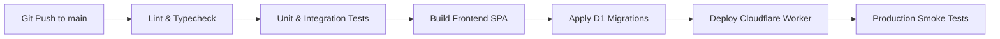

# Deployment Architecture & Operations: BusinessHub Enterprise

**Document Reference:** `docs/deployment/DEPLOYMENT.md`  
**Version:** 1.0.0  
**Target Infrastructure:** Cloudflare Workers, Cloudflare D1, Cloudflare R2, Cloudflare Static Assets  

---

## 1. Cloudflare Serverless Architecture

BusinessHub runs entirely on Cloudflare's serverless edge platform. This infrastructure guarantees:
- Sub-50ms global latency without managing physical servers or container clusters.
- Automatic horizontal scaling to match operational traffic spikes.
- Native edge colocation between Workers execution isolates and Cloudflare D1 database replicas.
- Zero server maintenance, zero OS patching, and automatic TLS 1.3 termination.

```
                              [ User Web Browser ]
                                       |
                              [ Cloudflare DNS ]
                            hub.yourcompany.com
                                       |
                     +-----------------+-----------------+
                     |                                   |
         [ Static Assets Cache ]              [ Cloudflare Workers ]
        React / Vite SPA Assets                    API Router
                     |                                   |
                     +-----------------+-----------------+
                                       |
                   +-------------------+-------------------+
                   |                                       |
         [ Cloudflare D1 ]                       [ Cloudflare R2 ]
     (SQLite Relational Edge DB)             (Object Storage Buckets)
         - Core Ledger Tables                    - Scanned Receipts
         - Financial Transactions                - Business Logo Assets
         - Audit Trail Logs                      - Invoice PDF Archives
```

---

## 2. Infrastructure Bindings Configuration (`wrangler.toml`)

The deployment is managed through Cloudflare's Wrangler configuration:

```toml
name = "businesshub-enterprise"
main = "src/index.ts"
compatibility_date = "2026-11-19"
compatibility_flags = ["nodejs_compat"]

# 1. Cloudflare D1 Database Binding
[[d1_databases]]
binding = "DB"
database_name = "businesshub-production-db"
database_id = "00000000-0000-0000-0000-000000000000"
migrations_dir = "migrations"

# 2. Cloudflare R2 Object Storage Binding
[[r2_buckets]]
binding = "STORAGE"
bucket_name = "businesshub-media-production"

# 3. Static Client Asset Hosting
[site]
bucket = "./dist"

# 4. Environment Variables
[vars]
ENVIRONMENT = "production"
BASE_URL = "https://hub.yourcompany.com"
SESSION_TTL_SECONDS = "604800"

# 5. Staging Environment Override
[env.staging]
name = "businesshub-enterprise-staging"
[[env.staging.d1_databases]]
binding = "DB"
database_name = "businesshub-staging-db"
database_id = "11111111-1111-1111-1111-111111111111"
[[env.staging.r2_buckets]]
binding = "STORAGE"
bucket_name = "businesshub-media-staging"
[env.staging.vars]
ENVIRONMENT = "staging"
BASE_URL = "https://staging-hub.yourcompany.com"
```

---

## 3. Environment Secrets Provisioning

Sensitive variables must NEVER be committed to version control. They are provisioned using Wrangler secrets:

```bash
# Set Session Signing Salt
npx wrangler secret put SESSION_SECRET_SALT

# Set Initial Bootstrap Setup Token
npx wrangler secret put BOOTSTRAP_TOKEN
```

---

## 4. Database Migration Lifecycle

Database migrations are stored sequentially in `migrations/` and managed using Wrangler D1 tools:

### 4.1 Local Development Migrations
```bash
# Apply migrations to local SQLite environment
npx wrangler d1 migrations apply DB --local
```

### 4.2 Staging Migrations
```bash
# Apply migrations to remote staging D1 instance
npx wrangler d1 migrations apply DB --env staging --remote
```

### 4.3 Production Migrations
```bash
# Apply migrations to remote production D1 instance
npx wrangler d1 migrations apply DB --remote
```

### 4.4 Non-Destructive Migration Principle
In accordance with enterprise banking and ERP standards, production migrations must always be **additive and non-destructive**:
- New columns must include default values or allow `NULL`.
- Columns are never dropped directly in production without a multi-phase deprecation cycle.
- Tables are never dropped in production migrations.

---

## 5. Continuous Integration & Deployment (CI/CD)



### GitHub Actions Pipeline (`.github/workflows/deploy.yml`):
```yaml
name: Deploy BusinessHub Enterprise

on:
  push:
    branches: [main]

jobs:
  test_and_deploy:
    runs-on: ubuntu-latest
    steps:
      - uses: actions/checkout@v4
      - uses: actions/setup-node@v4
        with:
          node-version: 20
      - run: npm ci
      - run: npm run lint
      - run: npm run test
      - run: npm run build
      - name: Apply D1 Database Migrations
        uses: cloudflare/wrangler-action@v3
        with:
          apiToken: ${{ secrets.CLOUDFLARE_API_TOKEN }}
          command: d1 migrations apply DB --remote
      - name: Deploy Worker and Static Assets
        uses: cloudflare/wrangler-action@v3
        with:
          apiToken: ${{ secrets.CLOUDFLARE_API_TOKEN }}
          command: deploy
```

---

## 6. Disaster Recovery & Backups

### 6.1 Cloudflare D1 Automated Backups
Cloudflare D1 provides automated daily snapshots and Point-in-Time Recovery (PITR).
- Automated backup schedule: Daily at 02:00 UTC.
- Retention period: 30 days.

### 6.2 Manual Production Export Script
For external compliance and local archives, run the export script:
```bash
npx wrangler d1 export businesshub-production-db --remote --output=./backups/d1_backup_$(date +%Y%m%d).sql
```

### 6.3 Recovery Procedure
To restore from a backup snapshot in case of catastrophic operational failure:
```bash
npx wrangler d1 execute businesshub-production-db --remote --file=./backups/d1_backup_20261119.sql
```
